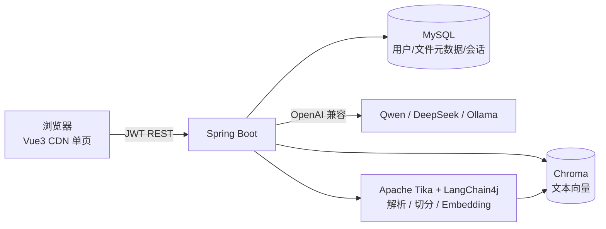

# 校园知识库 & 学习资料智能问答复习助手

基于 **RAG（检索增强生成）** 的校园问答与复习系统：既可以查询校规、教务、奖助、宿舍、毕业流程等校园事务，也可以上传课件 / 复习提纲 / 笔记，让 AI 帮你总结、划重点、讲解知识点、出题自测。

> 本项目严格按照 `demmand.md`（后端技术栈 + 系统提示词）与 `demmand_前端.md`（Vue3 CDN 单页前端）实现，是一个可以继续迭代的课程设计 / 大创初版。

## 1. 技术栈

| 模块 | 实现 |
|------|------|
| 后端 | Java 17 + Spring Boot 3.4.1 |
| RAG 框架 | LangChain4j 1.23.0（Tika 解析、递归分片、Embedding、Chroma 检索） |
| 向量数据库 | Chroma 0.5.15（Docker，API V1） |
| 关系数据库 | MySQL 8.4（JPA / Hibernate） |
| 文件解析 | Apache Tika（PDF / DOCX / PPT / PPTX / TXT / MD） |
| 大模型 | 通义千问 / DeepSeek / 任何 OpenAI 兼容 API；也支持 Ollama 本地模型 |
| 前端 | Vue 3 CDN + Tailwind CSS CDN + Font Awesome 4.7，**单个 index.html，无需 npm 构建** |
| 部署 | Docker / Docker Compose（MySQL + Chroma + App） |
| 鉴权 | Spring Security + JWT + BCrypt |

## 2. 已实现功能

- [x] 学生注册 / 登录，管理员账号自动初始化
- [x] 公共知识库（管理员上传，全校可检索）/ 个人私有知识库（学生上传，仅本人可访问）
- [x] PDF、DOCX、PPT、PPTX、TXT、Markdown 上传与 Tika 文本解析
- [x] 异步解析入库、状态轮询（排队中 / 解析中 / 已入库 / 失败）
- [x] 文档删除（级联删除向量）、重新入库、下载原文
- [x] 基于 LangChain4j + Chroma 的 Top-K 向量检索，带相关度阈值
- [x] 严格依据上下文的系统提示词、固定拒答话术、防作业代写 / 无关请求拦截
- [x] 多轮对话（后端按用户 + 会话隔离保存）
- [x] 复习模式：问答、总结、划重点、讲解、出题、多资料整合
- [x] 引用来源展示（文件名、片段序号、相关度、摘要）
- [x] Vue3 单页界面：顶部导航 + 320px 侧边栏 + 聊天区、拖拽上传、响应式
- [x] Docker Compose 一键部署，兼容 Ollama 本地模型
- [x] 核心单元 / 接口测试（`mvn test`）

## 3. 架构



**上传链路**：上传文件 → 本地磁盘保存 → 写 MySQL 元数据并返回“文件已接收” → 异步 Tika 解析 → LangChain4j 递归切分 → Embedding → 写入 Chroma（带 `fileId`、`accessOwnerId` 元数据）。

**问答链路**：JWT 识别用户 → 校验会话归属 → 意图护栏 → 按 `accessOwnerId = 0(公共) 或 当前用户` 过滤检索 → 组装系统提示词与上下文 → 调对话模型 → 保存回答与引用 → 返回前端。

**权限隔离**：Chroma 中每条向量都保存 `accessOwnerId`，公共资料为 `0`，私有资料为上传者用户 ID。检索过滤器为 `accessOwnerId in (0, 当前用户ID)`，从根本上阻止跨用户召回；管理员也不能读取学生私有资料正文。

## 4. 快速开始（Docker Compose）

### 4.1 准备

- Docker Desktop / Docker Engine 24+
- 一个大模型 API Key（推荐先使用阿里云百炼通义千问）
- 如果服务器不能访问外网，前端 CDN 资源需要改为本地文件（见第 8 节）

### 4.2 配置

```bash
cp .env.example .env
```

编辑 `.env`，至少填写：

```env
LLM_API_KEY=sk-你的百炼Key
EMBEDDING_API_KEY=sk-你的百炼Key
ADMIN_PASSWORD=换成一个强密码
JWT_SECRET=换成一串足够长的随机字符串
```

百炼兼容地址：

```env
LLM_BASE_URL=https://dashscope.aliyuncs.com/compatible-mode/v1
LLM_MODEL=qwen-plus
EMBEDDING_BASE_URL=https://dashscope.aliyuncs.com/compatible-mode/v1
EMBEDDING_MODEL=text-embedding-v3
EMBEDDING_DIM=1024
```

> DeepSeek 只提供对话模型，不提供 Embedding。若要使用 DeepSeek 对话，`LLM_BASE_URL` 改为 `https://api.deepseek.com/v1`、`LLM_MODEL=deepseek-chat`，同时 Embedding 仍使用百炼或 Ollama 的 `bge-m3`。

### 4.3 启动

```bash
docker compose up -d --build
docker compose logs -f app
```

访问 <http://localhost:8080>。

首次启动会自动创建管理员（仅当数据库中没有管理员时）：

- 用户名：`.env` 中的 `ADMIN_USERNAME`，默认 `admin`
- 密码：`.env` 中的 `ADMIN_PASSWORD`，示例值为 `change-me-admin-123456`

**请在第一次登录后通过右上角「修改密码」修改默认密码。**

### 4.4 清理数据

```bash
# 只停止
docker compose down
# 连 MySQL / Chroma / 上传文件一起清空（谨慎）
docker compose down -v
```

## 5. 使用本地开源模型（Ollama）

不需要任何云端 API Key，适合离线演示：

```bash
docker compose -f docker-compose.yml -f docker-compose.ollama.yml up -d --build
docker compose exec ollama ollama pull qwen2.5:7b
docker compose exec ollama ollama pull bge-m3
```

叠加配置会把后端切换到：

```env
LLM_BASE_URL=http://ollama:11434/v1
LLM_MODEL=qwen2.5:7b
EMBEDDING_BASE_URL=http://ollama:11434/v1
EMBEDDING_MODEL=bge-m3
EMBEDDING_DIM=1024
EMBEDDING_SEND_DIMENSIONS=false
```

CPU 运行 7B 模型会比较慢，建议至少 16GB 内存；有 NVIDIA GPU 时可在 `docker-compose.ollama.yml` 中为 `ollama` 增加 GPU 预留，或改用 vLLM 部署 Qwen。

也可以直接使用其他 OpenAI 兼容服务（vLLM、LM Studio、OneAPI 等），只要 `/v1/chat/completions` 与 `/v1/embeddings` 可用。

## 6. 本地开发（不使用 Docker）

### 6.1 只启动依赖（MySQL + Chroma）

使用开发覆盖文件，把 MySQL 暴露到宿主机 `127.0.0.1:3306`（Chroma 已映射到 `127.0.0.1:8000`）：

```bash
docker compose -f docker-compose.yml -f docker-compose.dev.yml up -d mysql chroma
docker compose -f docker-compose.yml -f docker-compose.dev.yml ps
```

如果直接使用 `docker compose up -d mysql chroma`，MySQL 只在 Compose 内部网络可见，IntelliJ 里的后端连不上 `localhost:3306`。

### 6.2 启动后端

复制并修改 `.env`（`application.yml` 会自动读取项目根目录的 `.env`）：

```bash
cp .env.example .env
```

`.env` 中至少确认：

```env
DB_PASSWORD=campus123456
CHROMA_URL=http://localhost:8000
LLM_API_KEY=sk-...
EMBEDDING_API_KEY=sk-...
```

然后启动默认 profile：

```bash
mvn spring-boot:run
```

也可以直接在 IntelliJ 运行 `CampusKbApplication`（Active profiles 留空，或填 `default`）。

### 6.3 无 MySQL / Chroma 的快速联调（推荐先跑这个）

项目内置 `local` profile：H2 内存库 + 内存向量库，不需要 MySQL、Chroma 或 Docker，适合先验证页面、登录、权限和拒答逻辑。

```bash
mvn spring-boot:run -Dspring-boot.run.profiles=local
```

- 地址：<http://localhost:8080>
- 管理员：`admin / admin123456`
- 数据不持久化，重启即清空
- `.env` 中的 `LLM_API_KEY` / `EMBEDDING_API_KEY` 会自动读取；不填 Key 时只能使用固定话术/页面功能，无法真实检索

在 IntelliJ 中运行：

- `Run` → `Edit Configurations...` → 选中 `CampusKbApplication`；
- 找到 **Active profiles**，填入 `local`；
- 点击 Run。

> `test` profile 是给 JUnit 测试用的，日常本地体验请使用 `local`。

> 注意：`local` profile 仅用于开发演示，不要用于生产。

## 7. API 一览

完整示例见 [docs/API.md](docs/API.md)。

| 方法 | 路径 | 说明 | 鉴权 |
|------|------|------|------|
| POST | `/api/auth/register` | 学生注册 | 否 |
| POST | `/api/auth/login` | 登录，返回 JWT | 否 |
| GET | `/api/auth/me` | 当前用户 | 是 |
| POST | `/api/auth/change-password` | 修改密码 | 是 |
| POST | `/api/file/upload` | 上传文件（`file` + 可选 `visibility`） | 是 |
| GET | `/api/file/myList` | 我的资料 | 是 |
| GET | `/api/file/publicList` | 公共资料 | 是 |
| DELETE | `/api/file/{fileId}` | 删除资料及向量 | 是 |
| POST | `/api/file/{fileId}/reindex` | 重新解析入库 | 是 |
| GET | `/api/file/{fileId}/download` | 下载原文 | 是 |
| POST | `/api/chat/ask` | 问答（可带 `mode`、`fileIds`） | 是 |
| GET | `/api/health` | 健康检查 | 否 |

问答请求示例：

```json
{
  "userId": 1,
  "question": "帮我划一下这份课件的复习重点",
  "conversationId": null,
  "mode": "keypoints",
  "fileIds": [3]
}
```

`mode` 可选：`qa` / `summary` / `keypoints` / `explain` / `quiz` / `integrate`。

## 8. 前端说明

前端文件：`src/main/resources/static/index.html`，单文件、无构建。Spring Boot 启动后访问 `/` 即可。

也可以直接用浏览器打开这个 HTML（接口地址变量 `API_BASE` 会自动指向 `http://localhost:8080`）。但必须保证后端已启动，且浏览器允许访问 CDN（Vue、Tailwind、Font Awesome）。

如果部署在内网 / 离线环境，下载以下三个文件到本地并替换 `<head>` 中的 CDN 地址：

- Vue 3 生产版 `vue.global.prod.js`
- Tailwind CSS CDN 脚本
- Font Awesome 4.7 CSS + 字体

前端只负责展示和调用接口，所有 RAG、Prompt、权限判断都在 Java 后端。

## 9. 测试

```bash
mvn test
```

当前测试覆盖：

- Spring 上下文、H2 数据库、安全配置
- 管理员登录、学生注册、未登录 401
- 意图护栏（作业代写 / 无关请求 / 寒暄）
- Prompt 构建、引用来源、对话历史
- 核心 RAG 元数据与提示词结构

## 10. 目录结构

```text
.
├── pom.xml
├── Dockerfile
├── docker-compose.yml
├── docker-compose.dev.yml
├── docker-compose.ollama.yml
├── .env.example
├── src/main/java/com/campus/kb/
│   ├── auth/          # JWT、登录注册、Security
│   ├── chat/          # 问答编排、Prompt、护栏、会话
│   ├── config/        # AppProperties、LangChain4j、异步线程池、管理员初始化
│   ├── file/          # 上传、Tika 解析、向量入库、文件管理
│   ├── rag/           # Chroma 检索与权限过滤
│   ├── user/          # 用户实体
│   └── common/        # 异常处理、健康检查
├── src/main/resources/
│   ├── application.yml
│   ├── application-local.yml
│   ├── application-test.yml
│   ├── prompts/system-prompt.txt
│   └── static/index.html
├── src/test/java/...
├── samples/           # 可上传的校园示例资料
└── docs/
    ├── API.md
    ├── ARCHITECTURE.md
    ├── DEPLOY.md
    ├── IDE_SETUP.md
    ├── 代码详解.md      # 后端每个类/每个方法的说明
    └── 需求对照.md
```

## 11. IntelliJ 构建报错？

如果 IDE 出现大量 `程序包 lombok 不存在`、`程序包 jakarta.persistence 不存在`，通常是 **Maven 工程没有导入**，不是代码错误。按 [IDE_SETUP.md](docs/IDE_SETUP.md) 操作：右键 `pom.xml` → Add as Maven Project → Reload All Maven Projects → 开启 Annotation Processing → **把 Project SDK 改成 JDK 17（不要用 openjdk-27）**。

## 12. 安全与边界

- 所有文件、会话接口都从 JWT 中取用户，**不信任请求体里的 `userId`**；只有 `/api/chat/ask` 保留了 `userId` 字段用于兼容前端约定，并会校验它与登录用户一致。
- 私有资料只能被上传者检索；管理员可以管理（删除 / 重建索引），但不会读取正文或私有向量。
- Chroma 过滤条件在服务端拼接，前端无法通过传 `fileIds` 越权。
- 上传文件按 UUID 重命名保存，数据库只保存相对文件名；下载前校验归属。
- 默认管理员密码和 JWT 密钥必须在部署前修改。
- 未实现 OCR：扫描版图片 PDF 会进入 `FAILED` 并返回需求文档规定的固定提示。
- `ddl-auto=update` 便于初版演示；正式上线建议改为 Flyway / Liquibase 管理表结构。

## 13. 后续可迭代

- 聊天历史列表 / 会话恢复（前端目前按需求文档只做内存保存）
- 复习提纲导出 PDF / Word
- 自测题作答、错题本
- 管理后台：公共知识库运营、用户管理、统计面板
- OCR（Tika + Tesseract）与图片型 PDF 支持
- SSE 流式输出、重排序模型（BGE Reranker）
- Milvus / 对象存储替换

## 14. 需求文档

- [demmand.md](demmand.md)：后端技术栈、系统提示词、功能边界
- [demmand_前端.md](demmand_前端.md)：前端布局、交互与接口约定